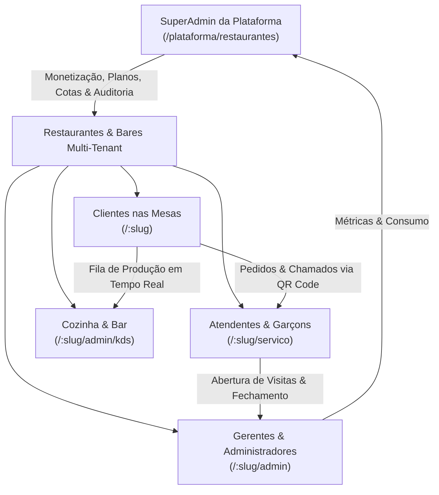
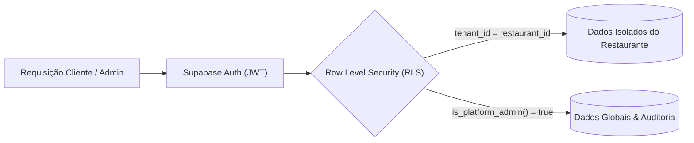

# Elozi — Plataforma SaaS Multi-Tenant de Cardápio Digital & Governança Operacional

> **Plataforma SaaS moderna e completa para restaurantes, bares e estabelecimentos gastronômicos.**<br/>
> Abrange desde a experiência interativa do cliente (Cardápio Digital via QR Code, comandas agrupadas e chamados) até a operação em tempo real (Painel do Garçom, KDS para Cozinha e Bar, Gestão de Mesas por Cotas) e o gerenciamento corporativo da franquia/plataforma (SuperAdmin Cockpit, motor de planos SaaS, cobrança, auditoria imutável e paywall de inadimplência).

---

## 📑 Sumário

- [1. Visão Geral da Plataforma](#1-visão-geral-da-plataforma)
- [2. Arquitetura e Stack Tecnológica](#2-arquitetura-e-stack-tecnológica)
- [3. Módulos do Sistema](#3-módulos-do-sistema)
  - [3.1. SuperAdmin SaaS Dashboard (`/plataforma/restaurantes`)](#31-superadmin-saas-dashboard-plataformarestaurantes)
  - [3.2. Motor de Planos SaaS, Cotas e Governança](#32-motor-de-planos-saas-cotas-e-governança)
  - [3.3. Paywall de Inadimplência e Tolerância Operacional](#33-paywall-de-inadimplência-e-tolerância-operacional)
  - [3.4. Painel Administrativo do Restaurante (`/:slug/admin`)](#34-painel-administrativo-do-restaurante-slugadmin)
  - [3.5. KDS — Kitchen Display System (`/:slug/admin/kds`)](#35-kds--kitchen-display-system-slugadminkds)
  - [3.6. Cardápio Digital do Cliente (`/:slug`)](#36-cardápio-digital-do-cliente-slug)
  - [3.7. App de Serviço para Garçons e Salão (`/:slug/servico`)](#37-app-de-serviço-para-garçons-e-salão-slugservico)
- [4. Segurança e Modelo de Dados (Supabase / PostgreSQL)](#4-segurança-e-modelo-de-dados-supabase--postgresql)
- [5. Estrutura do Repositório](#5-estrutura-do-repositório)
- [6. Configuração e Instalação Local](#6-configuração-e-instalação-local)
- [7. Suíte de Testes Automatizados](#7-suíte-de-testes-automatizados)
- [8. Diretrizes de Interface e Design System](#8-diretrizes-de-interface-e-design-system)

---

## 1. Visão Geral da Plataforma

O **Elozi** foi projetado para digitalizar o ciclo de atendimento e a gestão de restaurantes de ponta a ponta, dividindo o ecossistema em 4 personas principais:



---

## 2. Arquitetura e Stack Tecnológica

### Frontend
- **React 19** + **TypeScript 5.7 (Strict)**
- **Vite 6** (Build tooling e servidor HMR ultrarrápido)
- **Tailwind CSS v4** (Utility-first styling com design system consistente e suporte a tema claro/escuro)
- **React Router 7** (Roteamento declarativo com layouts aninhados e deep-linking)
- **Design System Monocromático**: Substituição integral de emojis por ícones SVG vetoriais lineares de alta fidelidade (`stroke="currentColor" strokeWidth="1.75"`).

### Backend & BaaS (Supabase / PostgreSQL)
- **PostgreSQL 15+** com isolamento estrito **Multi-Tenant via Row Level Security (RLS)**.
- **RPCs (Remote Procedure Calls)** em PL/pgSQL com `SECURITY DEFINER` e sanitização `SET search_path = ''` para mitigação de vulnerabilidades de schema poisoning.
- **Triggers Reativas**: Sincronização automática de cotas de mesas, cascade soft-deletes e auditoria imutável.
- **Supabase Realtime**: Assinatura de canais WebSockets para pedidos, chamados de garçom e status do KDS.
- **Supabase Storage**: Buckets seguros para fotos de pratos, identidades visuais de estabelecimentos e snapshots criptografados de backup (AES-256).

---

## 3. Módulos do Sistema

### 3.1. SuperAdmin SaaS Dashboard (`/plataforma/restaurantes`)
Cockpit executivo centralizado para gestão global da infraestrutura e portfólio de estabelecimentos:

- **Layout SaaS Corporativo**: Sidebar escura recolhível, topbar contextual e área central adaptável.
- **Cockpit Executivo & KPIs em Tempo Real**:
  - **MRR (Monthly Recurring Revenue)** calculado dinamicamente com base nos planos ativos.
  - Total de Estabelecimentos cadastrados, ativos e suspensos.
  - Mesas ativas em operação em toda a rede.
  - Indicador visual e barra de progresso da vigência das assinaturas com contagem regressiva de dias restantes.
- **Central de Alertas na Topbar**:
  - Sino de notificações interativo com contagem dinâmica em badge vermelha.
  - **Alertas Financeiros & Vencimentos**: Identifica restaurantes inadimplentes ou com vencimento próximo (≤ 7 dias), com botão de renovação rápida `+30d Renovar` diretamente no popover.
  - **Oportunidades de Upgrade**: Identifica automaticamente estabelecimentos que atingiram 80% ou mais da cota de mesas contratada.
- **Busca Global Avançada & Filtros Rápidos**:
  - Busca unificada por **Nome do Restaurante**, **Slug (`/slug`)** e **E-mails dos Administradores**.
  - Pílulas de filtro dinâmicas: `Todos`, `Ativos`, `Próximos do Vencimento`, `Cota Esgotada (≥ 80%)`, `Vencidos / Tolerância`.
- **Pipeline Seguro de Exclusão e Recuperação**:
  - Exclusão com confirmação explícita digitando o nome do restaurante.
  - Geração automática pré-exclusão de **manifesto de backup completo criptografado (AES-256)**.
  - Aba de **Histórico de Exclusões** com restauração pontual e download de manifestos.
- **Personalização White-Label da Plataforma**:
  - Configuração de Nome da Plataforma, Subtítulo, Logotipo institucional e Avatar do SuperAdmin com compressão automática em formato WebP no navegador.
  - Edição do catálogo padrão de planos SaaS (`Básico`, `Pro`, `Premium`).

---

### 3.2. Motor de Planos SaaS, Cotas e Governança

O Elozi possui um motor nativo de monetização com controle estrito de capacidade:

| Recurso | Plano Básico | Plano Pro | Plano Premium |
| :--- | :---: | :---: | :---: |
| **Preço Padrão Sugerido** | R\$ 99,00 / mês | R\$ 149,00 / mês | R\$ 199,00 / mês |
| **Cota Máxima de Mesas** | 10 mesas | 25 mesas | 50 mesas |
| **Ciclo de Vigência** | 30 a 365 dias | 30 a 365 dias | 30 a 365 dias |
| **Cardápio Digital & QR Code** | Sim | Sim | Sim |
| **Comandas & Painel do Garçom** | Sim | Sim | Sim |
| **KDS (Cozinha e Bar)** | Bloqueado (Paywall Comercial) | Liberado | Liberado |
| **Auditoria e Backups Dedicados** | Padrão | Avançado | Integral |

#### Governança de Mesas e Cotas:
- **Sincronização Bidirecional**: Ao realizar um downgrade de plano, o sistema mantém ativas exatamente as mesas permitidas pela nova cota e inativa as excedentes (`is_active = false`), impedindo abertura de atendimento nas mesas inativas.
- **Promoção Automática**: Ao excluir uma mesa ativa, se houver mesas excedentes inativadas na fila, a próxima mesa é promovida automaticamente para ativa sem exceder o limite.
- **Trava de Atendimento Ativo**: Mesas com comandas abertas não podem ser excluídas até que a conta seja devidamente encerrada.

---

### 3.3. Paywall de Inadimplência e Tolerância Operacional

Mecanismo robusto que protege as finanças da plataforma sem interromper bruscamente a operação de clientes em horário de pico:

```
[Vigente] ──> [Data de Expiração] ──> [Tolerância: 3 dias (Grace Period)] ──> [Suspenso (Expired)]
   Ativo                Aviso Financeiro              Atendimento Normal            Bloqueio Operacional
```

1. **Ativo (`active`)**: Assinatura regular dentro da data de vencimento.
2. **Tolerância Operacional (`grace_period`)**:
   - Vencido há até 3 dias.
   - O restaurante continua abrindo visitas e operando normalmente.
   - Banners informativos em tom âmbar são exibidos no painel administrativo alertando sobre a necessidade de renovação.
3. **Inadimplente / Suspenso (`expired`)**:
   - Vencido há mais de 3 dias.
   - **Bloqueio no Banco de Dados**: A função `open_table_visit` dispara erro `P0001` impedindo a abertura de novos atendimentos.
   - Banner vermelho de suspensão exibido no `AdminLayout` e na `TablesPage`, desabilitando a criação de novas mesas e abertura de visitas.

---

### 3.4. Painel Administrativo do Restaurante (`/:slug/admin`)

- **Salão de Mesas (`/:slug/admin/mesas`)**: Visualização em grade do status das mesas (Livre, Ocupada, Chamado de Garçom, Conta Solicitada), com monitor de cota de mesas contratadas.
- **Cardápio e Categorias (`/:slug/admin/cardapio`)**: Gestão de produtos, upload de fotos, controle de estoque/pausa de itens, tags de dieta (Vegano, Sem Glúten, etc.) e tempo estimado de preparo.
- **Equipe e Colaboradores (`/:slug/admin/equipe`)**: Gestão de membros com perfis `admin` e `staff`, geração de códigos de convite com expiração e revogação de acessos.
- **Identidade Visual (`/:slug/admin/identidade`)**: Personalização de cores da marca, capa, logo e taxas de serviço.
- **Manutenção de Mídia (`/:slug/admin/midia`)**: Auditoria e limpeza de imagens órfãs no storage.

---

### 3.5. KDS — Kitchen Display System (`/:slug/admin/kds`)

Sistema de exibição de pedidos em tempo real para equipes de produção:

- **Roteamento por Praças**: Separação automática entre itens de **Cozinha** e **Bar**.
- **Ciclo de Vida do Pedido**: Transições de status `Pendente` → `Em Preparo` → `Pronto` → `Entregue`.
- **Cálculo de Espera**: Temporizador em tempo real destacando pedidos prioritários ou atrasados.
- **Bloqueio Comercial**: Integrado ao motor de planos SaaS, impedindo acesso para estabelecimentos no Plano Básico com modal comercial direcionando para upgrade.

---

### 3.6. Cardápio Digital do Cliente (`/:slug`)

- **Acesso Sem Fricção**: Escaneamento de QR Code na mesa ou navegação por slug público.
- **Comandas Agrupadas (`table_tabs`)**: Permite que múltiplos clientes na mesma mesa compartilhem ou dividam o consumo com código de confirmação seguro de sessão.
- **Chamados Interativos**: Botão para solicitar atendimento do garçom ou pedir a conta com discriminação detalhada e taxa de serviço.
- **Interações Sociais**: Sistema de curtidas em pratos, avaliações, comentários com moderação automática e atalho para avaliações no Google Reviews.

---

### 3.7. App de Serviço para Garçons e Salão (`/:slug/servico`)

- Interface ergonômica otimizada para smartphones de atendentes de salão.
- Abertura rápida de mesas, lançamento de itens com adicionais e observações.
- Atendimento e confirmação de chamados de clientes em tempo real via WebSockets.

---

## 4. Segurança e Modelo de Dados (Supabase / PostgreSQL)

A integridade e segurança dos dados são garantidas diretamente na camada do banco:



- **Isolamento Multi-Tenant**: Toda tabela operacional possui vínculo obrigatório com `restaurant_id`, e as políticas RLS garantem que nenhum restaurante visualize ou altere dados de outro.
- **Proteção de Funções Críticas**:
  - RPCs administrativas utilizam `perform public.require_platform_admin();`.
  - RPCs do restaurante utilizam `perform public.require_restaurant_admin(p_restaurant_slug);`.
- **Trilha Imutável de Auditoria (`public.platform_audit_logs`)**:
  - Armazena histórico completo de alterações de planos, ciclos de faturamento, exclusões de mesas e configurações gerais.
  - Permissão RLS restrita a leitura pelo SuperAdmin; inserções automáticas via triggers/funções de governança; **atualizações e exclusões são proibidas no banco**.

---

## 5. Estrutura do Repositório

```text
Elozi/
├── .agents/skills/             # Guias de engenharia e boas práticas (React, Supabase, UI)
├── scripts/                    # Scripts utilitários e suíte de testes com PGLite
│   ├── test-saas-plans-and-limits-db.mjs    # Testes do motor SaaS, cotas, KDS, paywall e auditoria
│   ├── test-kds-production-db.mjs          # Testes do KDS de produção
│   ├── test-backup.mjs                     # Testes do pipeline de backup e criptografia
│   └── ...
├── src/
│   ├── app/                    # Entry points, roteamento central (React Router 7)
│   ├── features/               # Módulos verticais organizados por domínio de negócio:
│   │   ├── admin/              # Painel do Restaurante (Mesas, Cardápio, Equipe, Identidade)
│   │   ├── auth/               # Autenticação e controle de sessões
│   │   ├── comments/           # Sistema de avaliações e comentários
│   │   ├── explore/            # Descoberta pública de restaurantes
│   │   ├── kds/                # Kitchen Display System
│   │   ├── menu/               # Cardápio digital do cliente
│   │   ├── platform/           # SuperAdmin SaaS Dashboard (/plataforma/restaurantes)
│   │   ├── restaurants/        # Contexto e provedor de identidade do restaurante
│   │   ├── service/            # App de Garçom e salão (/servico)
│   │   ├── tables/             # Comandas e consumo
│   │   └── theme/              # Gerenciador de tema (Light / Dark)
│   ├── lib/                    # Cliente do Supabase e utilitários compartilhados
│   └── types/                  # Contratos e tipos TypeScript unificados
└── supabase/
    ├── migrations/             # 63 migrações incrementais organizadas cronologicamente
    └── seeds/                  # Seeds de dados de demonstração
```

---

## 6. Configuração e Instalação Local

### Pré-requisitos
- **Node.js**: versão 20 LTS ou superior (recomendado Node.js 22 ou 24).
- **NPM**: gerenciador de pacotes padrão.

### Passo a Passo

1. **Clonar o Repositório**:
   ```bash
   git clone <URL_DO_REPOSITORIO>
   cd Elozi
   ```

2. **Configurar as Variáveis de Ambiente**:
   Copie o arquivo de exemplo e preencha com as credenciais do seu projeto Supabase:
   ```bash
   cp .env.example .env.local
   ```
   Edite o arquivo `.env.local`:
   ```env
   VITE_SUPABASE_URL=https://seu-projeto.supabase.co
   VITE_SUPABASE_PUBLISHABLE_KEY=sua-chave-anon-publica
   ```

3. **Instalar Dependências**:
   ```bash
   npm install
   ```

4. **Executar em Modo de Desenvolvimento**:
   ```bash
   npm run dev
   ```
   Acesse a URL indicada no terminal (geralmente `http://localhost:5173`).

5. **Checagem de Tipos e Build de Produção**:
   ```bash
   # Validação TypeScript estrita sem emissão de arquivos
   npm run typecheck

   # Compilação otimizada de produção
   npm run build
   ```

---

## 7. Suíte de Testes Automatizados

O projeto conta com uma infraestrutura de testes de banco de dados executada em memória via **PGLite** (Postgres WASM), permitindo a validação completa de todas as migrações, funções PL/pgSQL, triggers e políticas RLS de forma isolada, rápida e sem necessidade de conexão externa ou Docker:

```bash
# Executa a suíte de validação de Planos SaaS, Limites, KDS, Paywall e Auditoria (14 testes)
node scripts/test-saas-plans-and-limits-db.mjs
```

### Principais Casos Testados:
- Projeção correta de planos (`basic`, `pro`, `premium`), preços e cotas.
- Bloqueio `42501` em chamadas de RPCs administrativas por usuários não autenticados ou sem privilégios de SuperAdmin.
- Trava de limite de mesas ativas no banco de dados (`P0001`).
- Sincronização automática de mesas (ativação/desativação) em upgrades e downgrades.
- Bloqueio comercial do KDS no plano Básico e liberação nos planos Pro e Premium.
- Paywall de inadimplência: bloqueio de visitas em estabelecimentos vencidos (`> 3 dias`) e liberação no período de tolerância (`grace_period`).
- Gravação imutável de registros em `platform_audit_logs`.

---

## 8. Diretrizes de Interface e Design System

- **Monocromático & Vetorial**: Uso estrito de ícones SVG lineares (`stroke="currentColor" strokeWidth="1.75"`), eliminando dependências de fontes de emojis que variam entre sistemas operacionais (Android, iOS, Windows).
- **Acessibilidade e Usabilidade**: Foco em contraste adequado para ambientes de salão e cozinha, estados de foco explícitos e componentes otimizados para toque (touch-friendly).
- **Feedback Transparente**: Modais com confirmação textual para ações destrutivas, banners contextuais de status financeiro e estados de carregamento com skeletons fluidos.

---

## 📄 Licença

Propriedade privada. Todos os direitos reservados à equipe **Elozi**.
